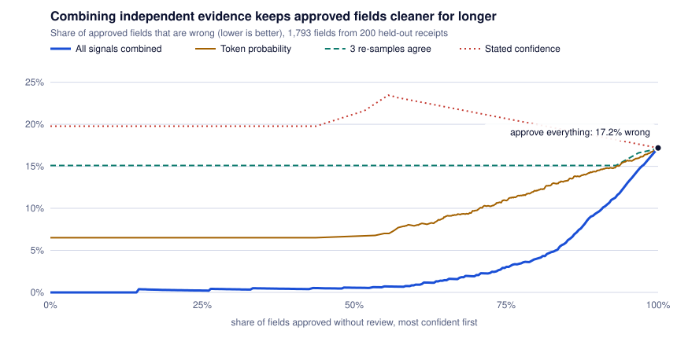

# fieldgate

Document extraction that knows which fields a person must check, and can prove how often the rest are wrong.

A model reads a receipt and returns its total, tax, change and so on. Most values are right. The business question is which ones can skip human review, and "the model said it was confident" is not an answer a finance team can sign. `fieldgate` scores every extracted value from four independent kinds of evidence, then picks the auto-approval cut with a statistical guarantee: with 95% confidence, at most the agreed share of approved values is wrong. Everything below the cut goes to a review queue.

It runs on a laptop CPU: [docling](https://github.com/docling-project/docling) for OCR, a 1.7-billion-parameter open model for extraction, no API key.

**Status:** complete for one dataset and one model. Results below are from 1,000 scanned receipts ([CORD v2](https://huggingface.co/datasets/naver-clova-ix/cord-v2)), 200 of them held out. See [Limits](#limits) before quoting anything.

## Results

Measured on 200 held-out receipts (1,793 fields). Full tables: [docs/results/cord.md](docs/results/cord.md).

<picture>
  <source media="(prefers-color-scheme: dark)" srcset="docs/img/risk-coverage-dark.svg">
  
</picture>

**1. The model alone is not good enough to trust.** 82.8% of fields are right, and only 18.5% of receipts have every field right.

**2. The usual confidence scores are weak; combining evidence is not.** AUROC is the chance that a right value outscores a wrong one (0.5 is a coin flip).

| score | AUROC (95% interval) |
|---|---|
| model's own stated confidence ("how sure are you, 0 to 100") | 0.410 (0.380-0.441) |
| agreement of 3 re-samples | 0.567 (0.546-0.593) |
| token probability of the value | 0.736 (0.701-0.768) |
| **all signals combined** | **0.949 (0.935-0.961)** |

Asking the model how sure it is was worse than a coin flip here.

**3. Certified auto-approval, per field.** The cut for each field was chosen on 400 calibration receipts and then applied to the 200 held-out ones.

| target: at most this share of approved values wrong | fields with a certified cut | fields approved without review | wrong among approved (held out) |
|---|---|---|---|
| 2% | 3 of 9 | 23% | 5 of 409 = 1.2% |
| 5% | 5 of 9 | 47% | 23 of 843 = 2.7% |
| 10% | 8 of 9 | 78% | 61 of 1,394 = 4.4% |

With no routing, 17.2% of values are wrong. The guarantee is per field; the pooled column is a description, not a second guarantee. Every individual field's held-out error rate came in under its target.

**4. The usual way of picking a cut fails about four times in ten.** The receipts were re-split 200 times; each time, every field got a cut chosen two ways and was checked on the held-out part (1,800 cuts per target).

| target | method | held-out error rate above target | mean share approved |
|---|---|---|---|
| 5% | loosest cut that looked fine on calibration | 40% | 75% |
| 5% | certified cut | 8% | 54% |
| 2% | loosest cut that looked fine on calibration | 44% | 56% |
| 2% | certified cut | 3% | 13% |

The held-out parts are small, so a cut whose true error rate is under target still misses sometimes by chance, which is why the certified row is not at or below 5% here. In a simulation where the true rate is known (`tests/test_certify.py`), the usual way exceeds a 2% target in 43% of 1,000 runs and the certified cut in 1.6%.

**5. Layout matters more than the model's confidence.** Rebuilding rows from the OCR boxes, so a label and its amount sit on one line, gives 82.8% field accuracy. Docling's reading-order text gives 58.8% on the same receipts with the same model.

**6. What it does not do.** No whole receipt can be auto-approved at any target, because the item count is only 51% right and never gets a cut. Every receipt is still opened; the saving is in fields checked (53% of them at the 5% target, 38% less review labour under the placeholder costs in the report).

## How it works

1. **Read.** Docling with RapidOCR reads the page. `fieldgate/layout.py` estimates the tilt of the photo and rebuilds rows from the word boxes.
2. **Extract.** `fieldgate/extract.py` writes the JSON skeleton itself and lets the model generate only each value. That gives an exact token probability per field, and the structure of the output is always valid. Three extra sampled answers and a stated-confidence question share the same prompt cache.
3. **Collect evidence.** `fieldgate/signals.py` produces 20 signals per value in four groups:
   - *model*: token probability, probability the field is absent
   - *agreement*: do the re-samples agree, what the model says its confidence is
   - *source*: is this number printed on the page, how sure was the OCR, is the field's label on the same row
   - *rules*: does cash − total = change, does subtotal + tax + service − discount = total
4. **Score.** `fieldgate/router.py` turns the signals into one probability that the value is right. Scores are always produced by a model that never saw that receipt.
5. **Certify.** `fieldgate/certify.py` picks the cut by Learn-then-Test (Angelopoulos et al., [arXiv 2110.01052](https://arxiv.org/abs/2110.01052)): exact binomial tests on a grid fixed in advance, walking from strict to loose and stopping at the first cut it cannot certify.
6. **Review and watch.** `fieldgate/app.py` serves a queue showing each receipt beside the fields that need a person, with the supporting OCR box outlined. A tenth of the approved fields is sampled for audit, and `fieldgate/audit.py` raises an alarm if their error rate drifts above target.
7. **Price it.** `fieldgate/cost.py` turns a policy into labour and shipped errors. The key number is the break-even error rate: the cost of one check divided by the cost of one error.

## Run it

Needs Python 3.11+ and about 10 GB of disk. No GPU.

```bash
pip install -e ".[pipeline,app]"
python -m unittest discover -s tests -t .          # 41 tests, no model or data needed

python -m fieldgate.fetch                          # CORD v2, about 2.3 GB
hf download Qwen/Qwen3-1.7B --local-dir .cache/models/Qwen3-1.7B

python -m fieldgate.run ocr --splits train validation test
python -m fieldgate.run extract --model .cache/models/Qwen3-1.7B --samples 3 --splits train validation test
python -m fieldgate.analyze --json docs/results/cord.json --out docs/results/cord.md
python -m fieldgate.chart docs/results/cord.json docs/img/risk-coverage

python -m fieldgate.app build --alpha 0.05         # route the held-out receipts
python -m fieldgate.app serve                      # http://127.0.0.1:8770
```

Extraction takes about 13 seconds per receipt on 8 cores, so the full run is roughly four hours. Every stage caches under `.cache/runs/` and resumes.

## Using it on a customer's documents

1. Replace the fields in `fieldgate/schema.py` and the arithmetic checks in `fieldgate/signals.py` with the customer's.
2. Have people label a few hundred documents. The table at the end of the [results](docs/results/cord.md) says how many a target needs: 59 approved values with none wrong for 5%, 299 for 1%, 2,995 for 0.1%. This is the first thing to tell someone who asks for 99.9%.
3. Agree the target per field from the break-even rate, using the customer's own cost of a check and cost of an error.
4. Run the queue, audit a sample of what was approved, and re-certify when the monitor alarms.

## Why these numbers can be trusted, and where I changed course

- Three separate sets of receipts: 400 to fit the scorer, 400 to choose cuts, 200 for every reported number.
- Intervals are bootstrapped over receipts, not fields, because fields of one receipt share their errors.
- The guarantee is tested by simulation in the test suite, where the true error rate is known.
- Labels are never sent to the review page (there is a test for it).

Two things happened that a reader should weigh:

- **I looked at the held-out receipts during development.** An early dry run used the first 200 extracted receipts, which are the held-out ones. No threshold or weight was set from it, but the list of signals and the shape of the report were settled with those receipts in view.
- **I changed the method once after the first full analysis, then re-ran it.** The first version certified the `discount` field at 2% and 5% but nothing at 10%, which cannot be right. The cause was the start of the certification walk: for a loose target it began on a few dozen values, where a single error ends it. The start now comes from where independent labelled data gives the strongest evidence, and there is a test that a looser target never approves less. In the same change the scorer became boosted trees instead of logistic regression, chosen by out-of-fold error on the fitting receipts only. The first version approved 138 of 200 totals at the 5% target with 4 wrong; this one approves 162 with 5 wrong. Both rules are valid; the numbers above are from the second.

## Limits

- **One dataset, one small model.** Indonesian shop and restaurant receipts and a 1.7B model. Nothing here says how the numbers move on invoices or with a stronger model, only that the method runs.
- **The guarantee assumes tomorrow's documents look like the calibration ones.** A new store format or a new scanner breaks it. The drift monitor is there to notice; it has only been tested on synthetic drift.
- **400 calibration receipts cannot certify much below 2%.** Tighter targets need more labels, as the sample-size table shows.
- **The item count is half wrong.** Part of that is the model and part is the labels, which count menu rows in ways the printed receipt does not always show. I kept the field and report it as it is.
- **A tilt that shifts a row by exactly one row height cannot be told apart from no tilt** using upright boxes. There is a test documenting it.
- **The cost figures are placeholders** ($18 an hour, 6 seconds per field) for a customer's own.
- **The review app is a single-user local demo.** It has been exercised through its API in tests, not used by reviewers.
- **Pooling approved fields across a receipt is not covered by the guarantee.** Each field has its own.

## Related work

- Learn-then-Test, Angelopoulos, Bates, Candès, Jordan, Lei ([arXiv 2110.01052](https://arxiv.org/abs/2110.01052)): the certification method.
- [arXiv 2606.24420](https://arxiv.org/abs/2606.24420): a multi-signal confidence engine for LLM field extraction, the closest prior work I found. It combines similar signals with a hosted model and reports accuracy at a coverage level, without a tested guarantee on the cut, and I found no released code.
- Docling and other extraction libraries return per-field confidence but leave the threshold to the user. That gap is what this project fills.

## Layout

```
fieldgate/   schema, data, ocr, layout, extract, signals, router, certify, evaluate, cost, audit, analyze, report, chart, app
tests/       41 offline tests
docs/        results and the chart
```

MIT licence. CORD v2 is CC BY 4.0 and is downloaded, not redistributed.
